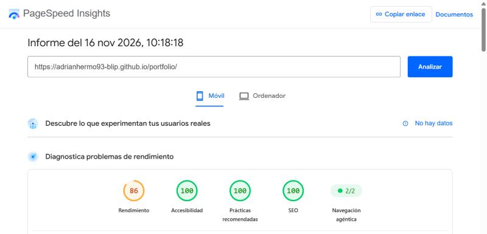
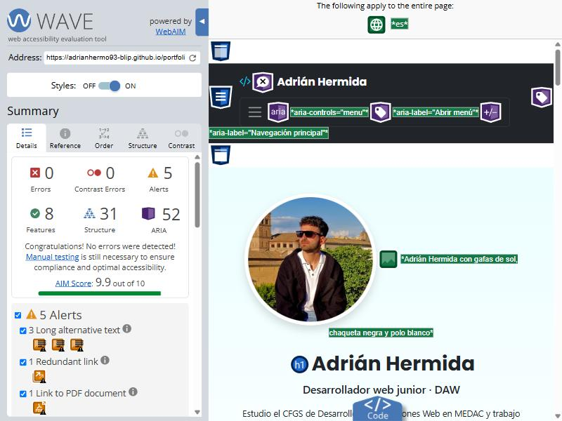
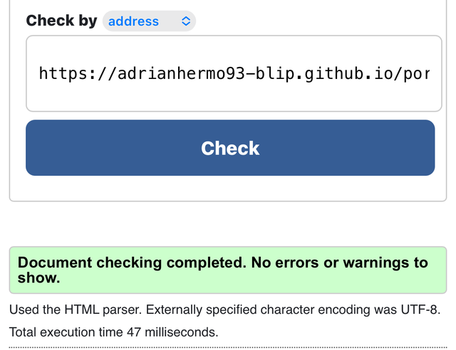
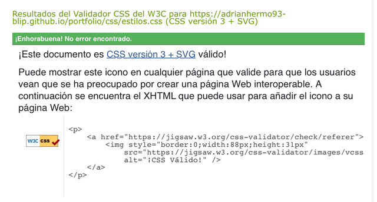

# Portfolio · Adrián Hermida

Portfolio profesional como desarrollador web junior, hecho con **HTML5 y Bootstrap 5.3** en el módulo de Diseño de Interfaces Web (2.º DAW).

🔗 **Web publicada:** https://adrianhermo93-blip.github.io/portfolio/

## Tecnologías

- HTML5 semántico
- CSS3 (estilos propios en `css/estilos.css`)
- Bootstrap 5.3.8 y Bootstrap Icons (CDN)
- JavaScript (validación del formulario y modales de Bootstrap)
- Google Fonts (Poppins)

## Estructura

```
index.html
css/estilos.css
js/main.js
img/             foto, capturas de los proyectos y favicon
docs/cv.pdf      currículum descargable
docs/evidencias/ capturas del informe de calidad
```

## Secciones

Sobre mí · Habilidades · Proyectos · Formación y experiencia · Contacto

## Componentes JavaScript

- **Modal** con el detalle de cada proyecto (botón «Ver detalle»).
- **Formulario de contacto** con la validación de Bootstrap, `type` y `autocomplete` en cada campo, mensajes de error y aviso de envío.

## Paleta de colores

| Color | Código | Uso |
|---|---|---|
| Azul agua | `#0e7490` | Color principal: botones, enlaces, badges e iconos |
| Azul agua oscuro | `#155e75` | Hover de botones y enlaces |
| Azul agua claro | `#ecfeff` | Fondo de la portada |
| Gris oscuro | `#212529` | Texto, navbar y footer |
| Gris medio | `#6c757d` | Badges secundarios y borde de los campos |
| Gris claro | `#f8f9fa` | Fondo de secciones alternas |
| Blanco | `#ffffff` | Fondo general |

Tipografías: **Poppins** para los títulos y la fuente del sistema para el texto.

### Contraste de las combinaciones usadas (WCAG 2.1 AA)

| Texto / elemento | Fondo | Ratio | Resultado |
|---|---|---|---|
| `#ffffff` (texto de botones y badges) | `#0e7490` | 5,36:1 | ✅ AA |
| `#0e7490` (enlaces, botones outline) | `#ffffff` | 5,36:1 | ✅ AA |
| `#0e7490` (texto de la portada) | `#ecfeff` | 5,15:1 | ✅ AA |
| `#0e7490` (iconos) | `#f8f9fa` | 5,08:1 | ✅ AA |
| `#ffffff` (hover de botones) | `#155e75` | 7,27:1 | ✅ AA |
| `#212529` (texto general) | `#ffffff` | 15,43:1 | ✅ AA |
| Texto secundario de Bootstrap | `#f8f9fa` | 6,58:1 | ✅ AA |
| `#ffffff` (badges secundarios) | `#6c757d` | 4,69:1 | ✅ AA |
| Enlaces de la navbar | `#212529` | 5,67:1 | ✅ AA |
| Fecha del footer | `#212529` | 4,94:1 | ✅ AA |
| Borde de los campos `#6c757d` | `#ffffff` | 4,69:1 | ✅ (mínimo 3:1) |
| Contorno de foco `#0e7490` | `#ffffff` | 5,36:1 | ✅ (mínimo 3:1) |
| Contorno de foco `#ffffff` (navbar y footer) | `#212529` | 15,43:1 | ✅ (mínimo 3:1) |

## Accesibilidad

- Enlace «Saltar al contenido» al principio de la página.
- Navegación completa con teclado y foco visible.
- Imágenes con `alt` descriptivo e iconos decorativos con `aria-hidden="true"`.
- Enlaces solo con icono con `aria-label`.
- Desplazamiento suave desactivado si el usuario tiene activado `prefers-reduced-motion`.

## Informe de calidad

| Herramienta | Resultado |
|---|---|
| Lighthouse (móvil) | Accesibilidad 100 · Buenas prácticas 100 · SEO 100 · Rendimiento 86 |
| WAVE | 0 errores · 0 errores de contraste |
| Validador HTML del W3C | Ver captura |
| Validador CSS del W3C | Ver captura |









## Declaración de uso de IA

He trabajado con Claude (Anthropic) como asistente para agilizar la maquetación, la redacción y el despliegue. El contenido, las decisiones de diseño y la revisión final (W3C y responsive) son míos.
